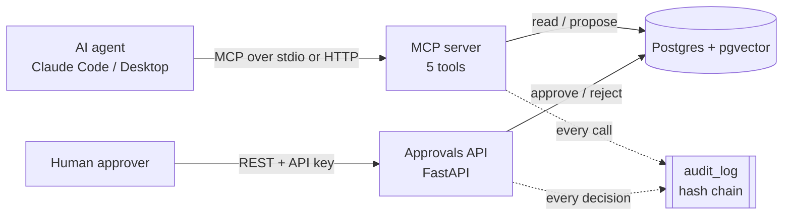

# store-agent-mcp

An MCP server that lets an AI agent (Claude Code, Claude Desktop, or any MCP client) work with a grocery store's product catalog, **without letting it change anything on its own.**

The agent can search products by meaning and propose price changes. A person approves or rejects each proposal through a small FastAPI service. Every tool call and every human decision goes into a hash-chained audit log that shows if anyone edits or deletes a row.

I built this to get hands-on with the parts of agentic systems I find most interesting: tool design, human-in-the-loop control and auditability. The domain comes from my day job building internal apps for a supermarket chain.

## How it works



**Agent-side tools (MCP)**

| Tool | What it does |
|---|---|
| `search_products` | Semantic search with pgvector ("something for a greek salad"), with price and stock filters |
| `get_product` | Full product details |
| `request_price_change` | Creates a *pending* request with a reason. Does not touch the price |
| `get_price_change_request` | Lets the agent see whether its request was approved or rejected, and why |
| `list_price_change_requests` | Recent requests by status |

There is deliberately no tool that changes a price. A test checks that none ever gets added.

**Human side (FastAPI, docs at `http://localhost:8088/docs`)**

`GET /requests`, `POST /requests/{id}/approve`, `POST /requests/{id}/reject`, `GET /audit`, `GET /audit/verify`

## Guardrails

- **Propose, don't act.** A write by the agent becomes a request. The price changes only when a human approves it.
- **No self-approval.** The identity that made a request can't decide it.
- **Stale requests can't be approved.** If the price changed after the agent asked, approval is refused and the agent has to propose again from the current price.
- **One open request per product,** enforced by a partial unique index in Postgres, not by a check-then-insert that could race.
- **Risk flag.** Changes over 30% (configurable) are marked `high` for the approver.
- **Clear refusals.** When a rule blocks a call, the agent gets the reason as a tool error (MCP `is_error`), so it can correct itself instead of retrying blindly.
- **Tamper-evident audit.** Each audit row stores a SHA-256 over its content plus the previous row's hash. `GET /audit/verify` walks the chain and names the first row that doesn't match, whether it was edited or deleted.

## Run it

Requires Docker and [uv](https://docs.astral.sh/uv/).

```bash
docker compose up -d --build          # Postgres + pgvector on :5544, approvals API on :8088 (localhost only)
uv sync
uv run store-agent-seed               # loads 31 products and computes their embeddings
```

Embeddings come from a small local model (`BAAI/bge-small-en-v1.5` via fastembed). No API key is needed, and product data never leaves the machine.

**Connect it to Claude Code.** The repo ships a `.mcp.json`, so opening Claude Code in this folder offers the `store-agent` server. Or run it headless:

```bash
claude -p "Find what a customer needs for a Greek salad and propose 10% off the feta" \
  --mcp-config .mcp.json --strict-mcp-config --allowedTools "mcp__store-agent__*"
```

**Then approve as a human:**

```bash
curl -H 'X-API-Key: dev-approver-key' localhost:8088/requests
curl -X POST -H 'X-API-Key: dev-approver-key' -H 'Content-Type: application/json' \
  -d '{"approver": "maria", "note": "OK for the promo"}' localhost:8088/requests/1/approve
curl -H 'X-API-Key: dev-approver-key' localhost:8088/audit/verify
```

To serve MCP over HTTP instead of stdio, use `uv run store-agent-mcp --http --port 8090`.

## Tests

```bash
uv run pytest
```

26 tests run against the real Postgres from docker compose, in a separate `store_test` database. They go through the actual MCP layer (`MCPServer.call_tool`) and the FastAPI app, not mocks. They cover the approval rules, the audit chain (including detecting an edited and a deleted row), and the full agent → human → agent loop.

One of them came out of the first end-to-end run with Claude. The agent called `search_products` seven times in parallel, and several of those calls each loaded the embedding model because none had finished loading yet. The model now loads once behind a lock, and the test fails if that ever regresses.

## Project layout

```
src/store_agent/
  tools.py          business logic, no MCP or HTTP; testable on its own
  mcp_server.py     MCP tools plus the audit wrapper
  approvals_api.py  FastAPI service for human decisions
  audit.py          hash-chained audit log and verification
  embeddings.py     local embedding model, plus a deterministic fake for tests
  seed.py           loads data/products.json
db/schema.sql       tables, constraints, HNSW index
```

## Known limits and what I'd do next

- **Approver identity** is a shared API key plus a name in the request body. A real setup would use SSO/OIDC, so the approver is whoever actually logged in.
- **The audit chain** catches edits by someone who doesn't rewrite every later row. To catch a full rewrite, the latest hash should be copied periodically somewhere the database admin can't write.
- **Evals:** a small set of scripted tasks ("find vegan protein options", "propose a discount with no reason") scored automatically, to catch regressions when tool descriptions or models change. For example, the small local model currently ranks spaghetti first for "something for breakfast". Evals would make misses like that measurable, so that changing the model or the embedded text is a decision based on numbers.
- **Edge deployment:** the MCP server and model are small enough to run on a single in-store box (k3s) against a local Postgres, syncing with the central catalog.
- **Agent-to-agent:** for example a pricing agent that proposes and a separate checker agent that reviews before a human sees it.
