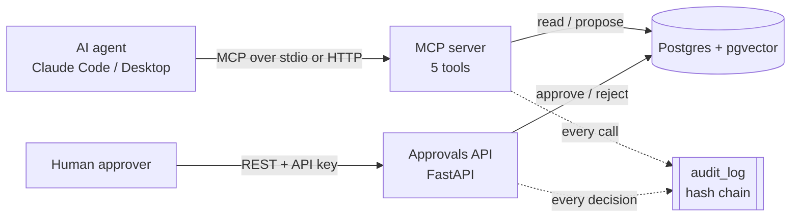

# store-agent-mcp

An MCP server that lets an AI agent (Claude Code, Claude Desktop, or any MCP client) work with a grocery store's product catalog, **without letting it change anything on its own.**

The agent can search products by meaning and propose price changes. A person approves or rejects each proposal through a small FastAPI service. Every tool call and every human decision goes into a hash-chained audit log that shows if anyone edits or deletes a row.

I built this to get hands-on with the parts of agentic systems I find most interesting: tool design, human-in-the-loop control and auditability. The domain comes from my day job building internal apps for a supermarket chain.

## How it works



**Agent-side tools (MCP)**

| Tool | What it does |
|---|---|
| `search_products` | Semantic search with pgvector ("something for a greek salad"), with price, stock and diet (vegan, vegetarian, dairy-free) filters |
| `get_product` | Full product details |
| `request_price_change` | Creates a *pending* request with a reason. Does not touch the price |
| `get_price_change_request` | Lets the agent see whether its request was approved or rejected, and why |
| `list_price_change_requests` | Recent requests by status |

There is deliberately no tool that changes a price. A test checks that none ever gets added.

**Human side (FastAPI)**

An approver console at `http://localhost:8088/`: pending requests shown as shelf tags with the agent's reason, approve or reject with a note, current shelf prices, and the audit log with a one-click integrity check. It is a single HTML file with no build step, and it calls the same API as anything else (`/docs` lists the endpoints):

`GET /requests`, `POST /requests/{id}/approve`, `POST /requests/{id}/reject`, `GET /products`, `GET /audit`, `GET /audit/verify`

Everything the agent writes (reasons, product names) is escaped before it reaches the page, since a reason is untrusted text.

## Guardrails

- **Propose, don't act.** A write by the agent becomes a request. The price changes only when a human approves it.
- **No self-approval.** The identity that made a request can't decide it.
- **Stale requests can't be approved.** If the price changed after the agent asked, approval is refused and the agent has to propose again from the current price.
- **One open request per product,** enforced by a partial unique index in Postgres, not by a check-then-insert that could race.
- **Risk flag.** Changes over 30% (configurable) are marked `high` for the approver.
- **Clear refusals.** When a rule blocks a call, the agent gets the reason as a tool error (MCP `is_error`), so it can correct itself instead of retrying blindly.
- **Tamper-evident audit.** Each audit row stores a SHA-256 over its content plus the previous row's hash. `GET /audit/verify` walks the chain and names the first row that doesn't match, whether it was edited or deleted.

## Run it

Requires Docker and [uv](https://docs.astral.sh/uv/).

```bash
docker compose up -d --build          # Postgres + pgvector on :5544, approvals API on :8088 (localhost only)
uv sync
uv run store-agent-seed               # loads 31 products and computes their embeddings
```

Embeddings come from a local multilingual model (`google/embeddinggemma-300m` via fastembed, 768 dimensions, 1.2 GB), so Greek and English queries both work. No API key is needed, and product data never leaves the machine. The model was picked by the evals below.

**Connect it to Claude Code.** The repo ships a `.mcp.json`, so opening Claude Code in this folder offers the `store-agent` server. Or run it headless:

```bash
claude -p "Find what a customer needs for a Greek salad and propose 10% off the feta" \
  --mcp-config .mcp.json --strict-mcp-config --allowedTools "mcp__store-agent__*"
```

**Then approve as a human:** open `http://localhost:8088/`, enter the approver key (`dev-approver-key` locally) and your name. Or with curl:

```bash
curl -H 'X-API-Key: dev-approver-key' localhost:8088/requests
curl -X POST -H 'X-API-Key: dev-approver-key' -H 'Content-Type: application/json' \
  -d '{"approver": "maria", "note": "OK for the promo"}' localhost:8088/requests/1/approve
curl -H 'X-API-Key: dev-approver-key' localhost:8088/audit/verify
```

To serve MCP over HTTP instead of stdio, use `uv run store-agent-mcp --http --port 8090`.

## Tests

```bash
uv run pytest
```

39 tests run against the real Postgres from docker compose, in a separate `store_test` database. They go through the actual MCP layer (`MCPServer.call_tool`) and the FastAPI app, not mocks. They cover the approval rules, the audit chain (including detecting an edited and a deleted row), and the full agent → human → agent loop.

One of them came out of the first end-to-end run with Claude. The agent called `search_products` seven times in parallel, and several of those calls each loaded the embedding model because none had finished loading yet. The model now loads once behind a lock, and the test fails if that ever regresses.

## Evals

Tests check that the code does what it should. Evals check that the model does: whether a search returns what a person would expect.

```bash
uv run store-agent-evals
```

[`evals/search_cases.json`](evals/search_cases.json) has 20 queries, in English and Greek. Each one lists the products that count as a good answer, and some list products that must not appear near the top. A case passes when one of the expected products is in the top 3 and none of the forbidden ones are. MRR (mean reciprocal rank) adds how high the first good product sits, and precision@3 adds how many of the top 3 are good (out of as many good products as the case lists, up to 3). The run needs no database: it embeds `data/products.json` in memory with the same text the seed uses.

The first run, with the English-only `BAAI/bge-small-en-v1.5`, scored 17/20. It returned spaghetti first for "something for breakfast", and missed "ψάρι για τη σχάρα" (fish for the grill) and "ελαιόλαδο" (olive oil). I compared two other 384-dimension models that fastembed ships:

| Model | Passed | MRR | Size |
|---|---|---|---|
| BAAI/bge-small-en-v1.5 (previous default) | 17/20 | 0.89 | 67 MB |
| snowflake/snowflake-arctic-embed-s | 15/20 | 0.75 | 130 MB |
| **paraphrase-multilingual-MiniLM-L12-v2** (chosen) | **20/20** | 0.86 | 220 MB |

The multilingual model fixes all three misses. In exchange, the best product sometimes comes second rather than first (lower MRR), and the model is about three times larger. For a Greek store, Greek queries working matters more. It has the same 384 dimensions, so the schema didn't change; re-run `uv run store-agent-seed` after switching.

The table above was scored before most cases had `must_not` lists. Passing only needs one good product in the top 3, so a result like chicken first for "vegan protein" still passed. With products that are clearly wrong now forbidden (meat and dairy for vegan, spaghetti for a Greek salad, orzo for tzatziki, bananas for spanakopita), the current model scores **16/20, MRR 0.86, precision@3 0.83**. The four failures were recipe-style English queries.

What fixed most of them, and what didn't:

| Change | Main set (20) | Held-out set (10) |
|---|---|---|
| Stricter cases, no changes | 16/20, MRR 0.86, P@3 0.83 | 2/10, MRR 0.28, P@3 0.20 |
| Tags in the embedded text (diet, dishes, Greek name) | 17/20, MRR 0.88, P@3 0.89 | 3/10, MRR 0.43, P@3 0.27 |
| Plus a `diet` filter on search | **18/20**, MRR 0.88, P@3 0.89 | **6/10**, MRR 0.62, P@3 0.40 |

[`evals/holdout_cases.json`](evals/holdout_cases.json) was written before any of these changes and never tuned against, so it shows whether a gain carries over to new queries (`--cases evals/holdout_cases.json`). Tags helped a little. They also showed why diet queries fail: embeddings ignore negation, so tagging chicken "not vegetarian" pulled it *towards* "vegetarian dinner". Exclusion is now a `diet` column and filter instead, and the tool description tells the agent to set it. In the evals, a case's `diet` field stands in for the agent setting the filter, so those cases measure search given the right filter, not whether the agent picks it. The remaining misses ("salad dressing", "what goes in a horiatiki", "υλικά για τζατζίκι") are recipe questions the small model doesn't connect to ingredients.

### Larger models

To fix those, I scored five multilingual models on both sets. Each one used the query and document prefixes its model card asks for (fastembed doesn't add them):

| Model | Dim | Size | Main set (20) | Held-out set (10) |
|---|---|---|---|---|
| paraphrase-multilingual-MiniLM-L12-v2 (previous default) | 384 | 0.22 GB | 18, MRR 0.88, P@3 0.89 | 6, MRR 0.62, P@3 0.40 |
| paraphrase-multilingual-mpnet-base-v2 | 768 | 1.0 GB | 19, MRR 0.87, P@3 0.82 | 8, MRR 0.72, P@3 0.55 |
| intfloat/multilingual-e5-large | 1024 | 2.24 GB | 19, **MRR 0.96**, P@3 0.86 | 9, **MRR 0.91**, P@3 0.70 |
| Qwen/Qwen3-Embedding-0.6B (int8) | 1024 | 1.12 GB | 19, MRR 0.90, P@3 0.83 | 9, **MRR 0.91**, P@3 0.63 |
| **google/embeddinggemma-300m** (now default) | 768 | 1.24 GB | **20**, MRR 0.93, **P@3 0.93** | 9, MRR 0.86, **P@3 0.75** |

Every larger model does better on the held-out set, which is the clearest signal. EmbeddingGemma is the only one that passes all 20 main cases and has the best precision on both sets, and it embeds about 3× faster than e5-large and 6× faster than Qwen. With sets this small, a one-case difference is noise, so the choice between the top three is close. Its one miss is "χορτοφαγικό φαγητό" (vegetarian food). It is released under the Gemma Terms of Use rather than an OSI licence; e5-large (MIT) is the closest alternative if that matters.

Switching changed the vector size from 384 to 768: run `db/migrations/002_embedding_768.sql`, then `uv run store-agent-seed`. The seed keeps live prices and stock.

### A small, open-source option

EmbeddingGemma's licence and size matter if the server runs on a small box in each store, or if only OSI-licensed models are allowed. The open-source models fastembed ships that are smaller than EmbeddingGemma, scored on both sets:

| Model | Licence | Dim | Size | Main set (20) | Held-out set (10) | Per query |
|---|---|---|---|---|---|---|
| google/embeddinggemma-300m (default) | Gemma | 768 | 1.24 GB | 20, MRR 0.93, P@3 0.93 | 9, MRR 0.86, P@3 0.75 | not measured |
| **minishlab/potion-multilingual-128M** | MIT | 256 | 0.51 GB | 19, MRR 0.91, P@3 0.87 | **9**, MRR 0.91, P@3 0.62 | **0.04 ms** |
| paraphrase-multilingual-mpnet-base-v2 | Apache-2.0 | 768 | 1.0 GB | 19, MRR 0.87, P@3 0.82 | 8, MRR 0.72, P@3 0.55 | not measured |
| paraphrase-multilingual-MiniLM-L12-v2 | Apache-2.0 | 384 | 0.22 GB | 18, MRR 0.88, P@3 0.89 | 6, MRR 0.62, P@3 0.40 | 5.3 ms |

Per-query time is one query embedded on a laptop CPU, averaged over 50 runs.

`potion-multilingual-128M` is a static model: it looks up a stored vector for each token and averages them instead of running a transformer. That makes it about 100× faster than MiniLM and small enough for any in-store machine, and it matches EmbeddingGemma on the held-out set. The cost is that it ignores word order and context. It missed "τυρί για χωριάτικη σαλάτα" (cheese for a horiatiki, feta not in the top 3) and returned the souvlaki itself for "dip to serve with souvlaki". It also has fewer good products in its top 3 on the held-out set (P@3 0.62 against 0.75).

So the choice depends on where search runs. On a central server where the Gemma licence is acceptable, keep EmbeddingGemma. On edge hardware, or where only open-source licences are allowed, use potion; `intfloat/multilingual-e5-large` (MIT) is the higher-quality open option if size doesn't matter. To score potion yourself: `uv run store-agent-evals --model minishlab/potion-multilingual-128M`. Making it the default would need `DEFAULT_MODEL` and `DIM = 256` in `embeddings.py`, a migration to `vector(256)` like `002_embedding_768.sql`, and a re-seed.

Twenty cases is a small set I wrote myself. The next step is to add real queries from users as they come in. The command exits 1 below a 90% pass rate (`--min-pass-rate`, 0 to never fail), so it can run in CI on every change to the model or the embedded text. `--model` scores any other fastembed model without changing the default.

## Project layout

```
src/store_agent/
  tools.py          business logic, no MCP or HTTP; testable on its own
  mcp_server.py     MCP tools plus the audit wrapper
  approvals_api.py  FastAPI service for human decisions
  static/console.html  approver console served at /
  audit.py          hash-chained audit log and verification
  embeddings.py     local embedding model, plus a deterministic fake for tests
  seed.py           loads data/products.json
  evals.py          scores search quality against evals/search_cases.json
db/schema.sql       tables, constraints, HNSW index
```

## Known limits and what I'd do next

- **Approver identity** is a shared API key plus a name in the request body. A real setup would use SSO/OIDC, so the approver is whoever actually logged in.
- **The audit chain** catches edits by someone who doesn't rewrite every later row. To catch a full rewrite, the latest hash should be copied periodically somewhere the database admin can't write.
- **Agent evals:** the evals above score search only. The next layer is scripted agent tasks ("propose a discount with no reason" should be refused, "find vegan protein" should call search before answering), run through `claude -p` and scored on which tools were called and what the final answer says.
- **Edge deployment:** the MCP server and model are small enough to run on a single in-store box (k3s) against a local Postgres, syncing with the central catalog.
- **Agent-to-agent:** for example a pricing agent that proposes and a separate checker agent that reviews before a human sees it.
